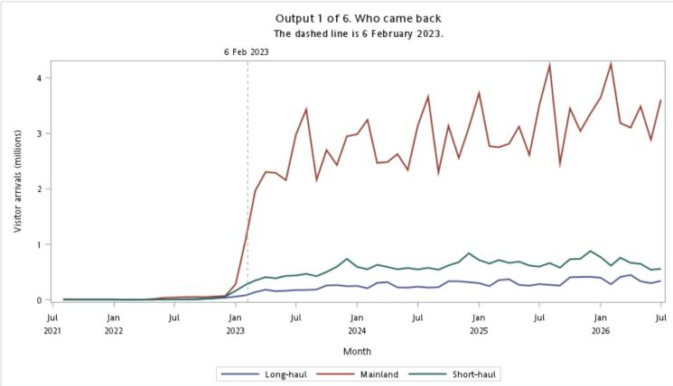
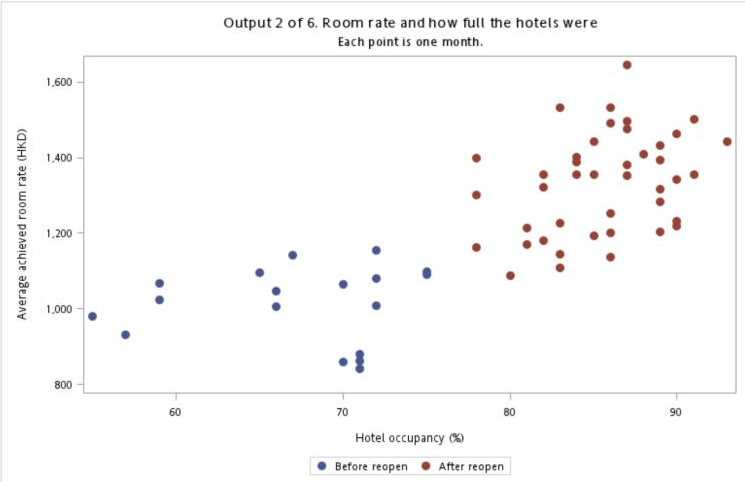

# Hong Kong Tourism Recovery and Hotel Room Rates (SAS)

STAT 3660SEF group project. One SAS program that answers a simple question:

> After Hong Kong fully reopened to the Mainland on **6 February 2023**, what happened to visitors and to hotels?

The program merges four public data sources into **one row per month (60 months, Aug 2021 to Jul 2026)** and prints **six outputs**.

| # | Output | What it shows |
|---|--------|---------------|
| 1 | Line chart | Visitor arrivals by market (Mainland, short-haul, long-haul) with a dashed line at the reopening |
| 2 | Scatter plot | Room rate against hotel occupancy, coloured Before / After reopening |
| 3 | Table (`PROC MEANS`) | Yearly averages of visitors, occupancy, room rate and temperature |
| 4 | Table (`PROC PRINT`) | The four highest and lowest months for room rate and for occupancy |
| 5 | t-tests (`PROC TTEST`) | After minus Before reopening, for room rate and occupancy |
| 6 | Table | Two room-rate models compared on hidden 2025–26 months |




---

## What you need to do

You need **SAS** with **Excel import** (`PROC IMPORT ... DBMS=XLSX`). The easiest way is the free
[SAS OnDemand for Academics](https://welcome.oda.sas.com/) (SAS Studio in your browser). It already includes everything required.

### 1. Download this repo
Click **Code → Download ZIP** on GitHub and unzip it (or `git clone` it).

### 2. Upload it to SAS Studio, keeping the folder structure
In SAS Studio, open **Server Files and Folders → Files (Home)**, create a folder (for example `tourism`), and upload so that it looks like this:

```
tourism/                      <- your project folder
├── tourism_recovery.sas
└── data/                     <- must be named exactly "data" (lowercase)
    ├── arrivals_650_80001.xlsx
    ├── hko_daily_temp.csv
    ├── hotel_occupancy_monthly.csv
    ├── hotel_room_rate_monthly.csv
    └── reopen_policy.dat
```

> SAS OnDemand runs on Linux, so **folder and file names are case-sensitive**. `data` is not the same as `Data`.
> The `output` folder is created automatically on the first run.

### 3. Paste your folder path into the program (line 26)
Open `tourism_recovery.sas` and change

```sas
%let proj = ;
```

to the path of **the folder that contains `data`**, with no slash at the end. For example:

```sas
%let proj = /home/u12345678/tourism;
```

Tip: in SAS Studio, right-click your folder, choose **Properties**, and copy the **Location** path.

### 4. Run it
Open the program and press **Run** (the running-person icon, or `F3`). Open the **Results** tab to see Outputs 1–6.
The two charts are also saved as PNG files in `output/`.

---

## How to check it worked

Look at the **Log** tab: there should be **no red `ERROR` lines**. Then compare these numbers with your results:

| Check | Expected |
|-------|----------|
| Rows in the monthly table | 60 (18 Before reopen, 42 After reopen) |
| Output 5, room rate | +318.0 HKD, pooled t = 9.06, p < .0001 |
| Output 5, occupancy | +18.18 points, Satterthwaite t = 11.63, p < .0001 |
| Output 6, holdout error | Model A = 104.320, Model B = 186.323 HKD |

## Troubleshooting

| Problem | Fix |
|---------|-----|
| `ERROR: Physical file does not exist, .../data/...` | The path in line 26 is wrong, or the folder is not named exactly `data` (lowercase). |
| `ERROR: File WORK.ARRIVALS_RAW.DATA does not exist` | The Excel file was not found. Fix the path above and run again from the top. |
| Nothing appears in Results | Run the whole program, not just one selected step. |
| Excel import fails on your own computer | `PROC IMPORT` with `DBMS=XLSX` needs *SAS/ACCESS Interface to PC Files*. Use SAS OnDemand instead. |

## Using new or updated data

Some values are fixed in the program, so update them if you change the data files:

- the Excel range `Arrivals$A4:JM19` and the month columns `m200401--m202608`
- the start month `"01aug2021"d` (first month of the hotel data)
- the training / test cut-off `"01dec2024"d`

## Method notes

- **Before / After** is split at the reopening month (rows are dated the 1st of each month, so 6 Feb 2023 counts as February 2023).
- **Output 5** runs a two-sample t-test. The Folded F test decides whether to read the *pooled* or *Satterthwaite* result.
- **Output 6** trains on Aug 2021 – Dec 2024 and scores Jan 2025 onward. Model A uses calendar month only. Model B adds occupancy, arrivals and temperature.
- **Caveat:** months in a row are not independent, so the p-values look stronger than they really are. The size of the change matters more than the p-value. The results show what happened, not that reopening alone caused it.

## Data sources

The files in `data/` come from public sources. Please check each provider's terms before reusing them.

| File | Source |
|------|--------|
| `arrivals_650_80001.xlsx` | Census and Statistics Department, Hong Kong: table 650-80001, visitor arrivals by nationality / region |
| `hotel_occupancy_monthly.csv`, `hotel_room_rate_monthly.csv` | Hong Kong hotel statistics: monthly room occupancy rate and average achieved room rate |
| `hko_daily_temp.csv` | Hong Kong Observatory: daily mean temperature |
| `reopen_policy.dat` | Key policy dates used by the program (reopening and the arrival-card change) |

## License

The code is released under the MIT License (see `LICENSE`). The data files keep their original providers' terms.
